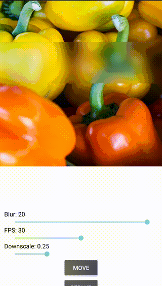

# Ti.Blurview
## Android BlurView module for Titanium SDK

<span class="badge-buymeacoffee"><a href="https://www.buymeacoffee.com/miga" title="donate"></a></span>

<br/>

Simple Android BlurView module for Titanium SDK. Static mode uses PixelCopy + RenderEffect; live mode uses https://github.com/Dimezis/BlurView

### Usage


```xml
<modules>
  <module platform="android">ti.blurview</module>
</modules>
```

```xml
<BlurView module="ti.blurview"/>
```
or
```javascript
var blur = require("ti.blurview");
var blurView = blur.createBlurView({});
```

### API

<b>Properties:</b>
* blurRadius (number, dp, default 20)
* backgroundColor (color, default `#88000000`): the tint drawn over the blur
* indicator (boolean, default false): shows a native spinner centred in the view
* indicatorColor (color, default: the theme's accent colour)
* mode (string, creation only, default `"static"`)
  * `"static"`: takes one snapshot of what is behind the view each time it becomes visible (e.g. `show()`), then blurs it. Cheap, made for loading overlays and dialogs. Blur via RenderEffect on Android 12+, a downscaled snapshot on Android 8–11, tint only on Android 7.
  * `"live"`: re-blurs whenever the content behind changes ([Dimezis BlurView 2.0.6](https://github.com/Dimezis/BlurView)). Costs a full software redraw of the window on every frame that changes; use only when the content behind really moves.

### Example:

```javascript
var win = Ti.UI.createWindow({
	backgroundColor: "#fff"
});
var img = Ti.UI.createImageView({
	image: "https://raw.githubusercontent.com/CameraKit/blurkit-android/master/demo/src/main/res/drawable-nodpi/peppers.png",
	width: 640,
	height: 400,
	top: 0
})
var contentView = Ti.UI.createView({
	height: 100,
	top: 100
})
var lbl = Ti.UI.createLabel({
	text: "Content",
	color: "#000"
})
var blurview = require("ti.blurview").createBlurView({
	blurRadius: 20,
	backgroundColor: "#55ffffff"
});
var view_menu = Ti.UI.createView({
	bottom: 0,
	height: Ti.UI.SIZE,
	width: Ti.UI.FILL,
	layout: "vertical",
	backgroundColor: "#efefef"
})
contentView.add(blurview)
contentView.add(lbl)
win.add([img, contentView, view_menu]);

var lbl1 = Ti.UI.createLabel({
	text: "Blur: 2",
	color: "#000",
	left: 10,
	top: 10
});
var slider1 = Ti.UI.createSlider({
	min: 1,
	max: 20,
	left: 20,
	right: 20,
	value: 20,
	bottom: 10
})
view_menu.add([lbl1, slider1]);

slider1.addEventListener("change", function(e) {
	blurview.blurRadius = Math.round(e.value);
	lbl1.text = "Blur: " + Math.round(e.value);
});

var btn1 = Ti.UI.createButton({
	title: "move"
})

view_menu.add(btn1);

btn1.addEventListener("click", function(e) {
	contentView.animate({
		top: 400,
		duration: 4000,
		autoreverse: true
	})
});

win.open();
```
